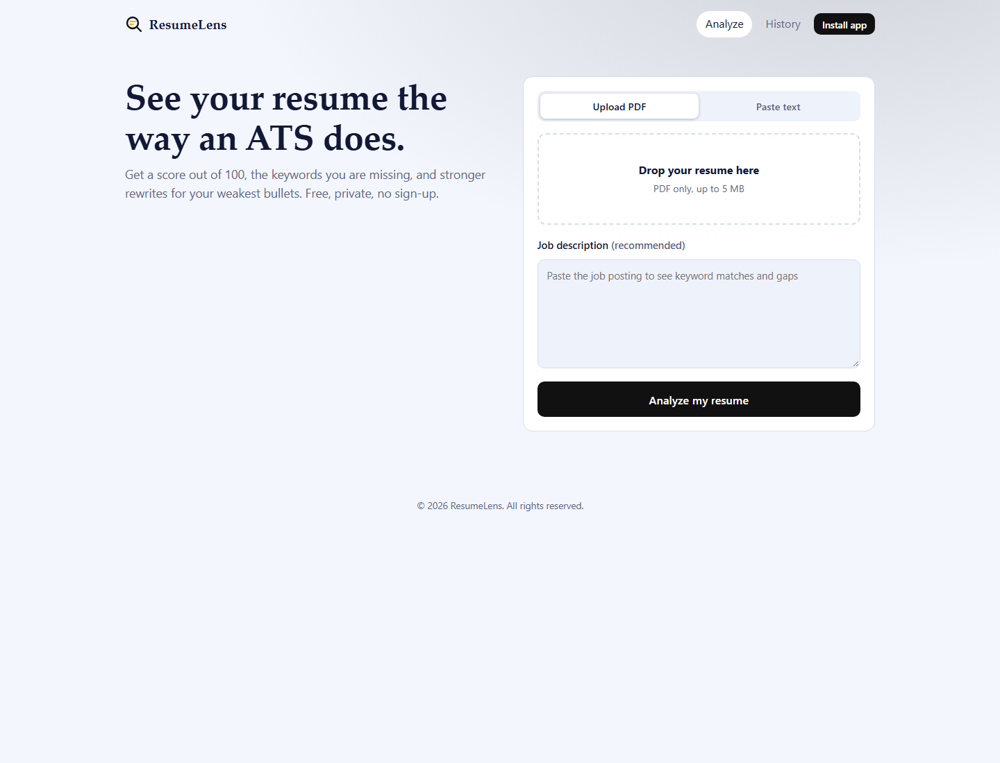
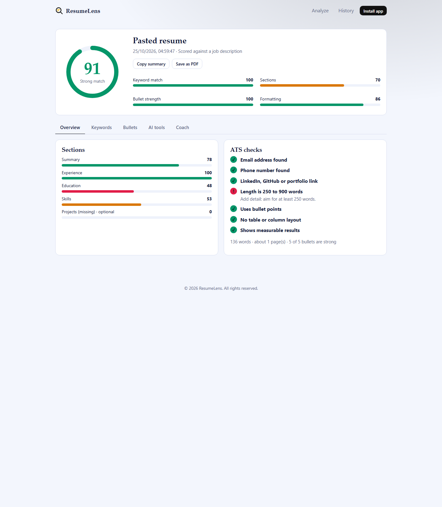
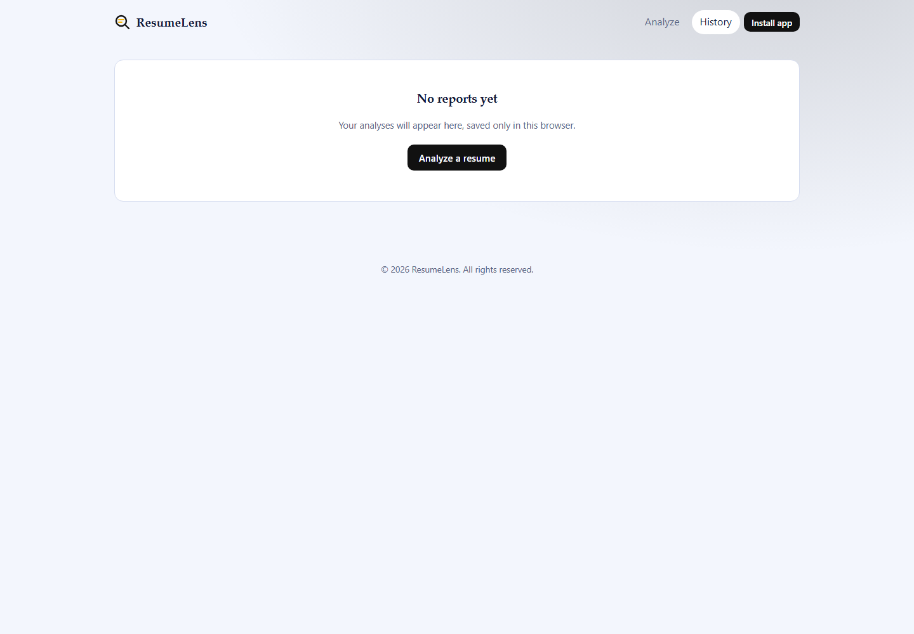

# ResumeLens: AI Resume Analyzer and ATS Checker

ResumeLens scores a resume the way an Applicant Tracking System (ATS) would. Upload a PDF (or paste text), add a job description, and get a score out of 100, the keywords you are missing, stronger rewrites for your weakest bullets, and an AI coach you can chat with.

It is a **website and an installable app (PWA)** built with one stack: Next.js, React, Node.js, JavaScript, HTML and CSS. There is no database.

## Screenshots

Click any screenshot to open the full-size image.

| Analyze | Report | History |
|---|---|---|
| <a href="./public/screenshots/analyze.png"></a> | <a href="./public/screenshots/report.png"></a> | <a href="./public/screenshots/history.png"></a> |

---

## Features

**Analysis (rule-based, no AI needed)**
- ATS score out of 100 with four sub-scores: keyword match, sections, bullet strength, formatting
- Keyword match and gaps against a pasted job description
- Section detection: Summary, Experience, Education, Skills (required) and Projects (optional)
- Bullet strength check: weak openings, missing numbers, length, vague words
- Seven ATS checks: email, phone, links, length, bullet points, no tables or columns, measurable results

**AI features (optional, needs an API key)**
- Rewrites of your six weakest bullets (before and after view)
- Professional summary, cover letter draft, and likely interview questions
- **Coach chat** on the Report page: ask about your score, tailor your summary, review your skills section, or run a mock interview

**App features**
- Drag-and-drop PDF upload, or paste resume text
- History page with a score-over-time chart (saved in the browser)
- Copy summary, and Save as PDF (browser print)
- Light theme
- Installable PWA with offline access to pages you have already visited
- Responsive layout for phones, tablets and desktops

---

## Tech stack

### Frontend (runs in the browser)
| Technology | Version | Used for |
|---|---|---|
| React | 18.3.1 | All UI: upload form, score gauge, tabs, chips, bullet diff view, coach chat |
| Next.js (App Router) | 14.2.15 | Pages and routing (Home, Report, History) |
| JavaScript (ES modules) | | All logic, in `.js` and `.jsx` files (no TypeScript) |
| HTML | | Forms, file input, semantic and accessible page structure |
| CSS | | One stylesheet (`app/globals.css`): CSS variables, light/dark themes, SVG gauge, responsive grid, print styles |
| SVG | | Score gauge, history chart, logo (hand-written, no chart library) |
| Browser APIs | | `localStorage` (history, theme), Clipboard, FormData, Drag and Drop, Print |

Fonts are system fonts, so the page loads no external font files.

### Backend (runs on the server, in Node.js)
| Technology | Version | Used for |
|---|---|---|
| Node.js | 18.17 or newer | Runtime for the Next.js route handlers |
| Next.js Route Handlers | 14.2.15 | `/api/analyze` and `/api/chat`. No separate Express server |
| `pdf-parse` | 1.1.1 | Extracts text from PDF files (imported from `pdf-parse/lib/pdf-parse.js` to avoid a known test-file bug) |
| `fetch` (built in) | | Calls the Gemini API from the server |

Resumes are read from memory and never written to disk or a database.

### AI
| Part | Details |
|---|---|
| Provider | Google Gemini API (free tier available), called with `fetch` (no SDK) |
| Default model | `gemini-flash-latest` (change with `GEMINI_MODEL`) |
| Where | Server only (`lib/llm.js`, `lib/ai.js`, `app/api/chat/route.js`). The API key never reaches the browser |
| Used for | Bullet rewrites, summary, cover letter, interview questions, coach chat |
| Not used for | The ATS score. It is plain JavaScript, so the same resume always gets the same score |
| Without a key | The app still works: scoring is unchanged, rewrites and the summary use simple templates, and the coach is turned off |

### PWA (app features)
| Part | File | Details |
|---|---|---|
| Manifest | `app/manifest.js` | Name, colors, standalone display, icons |
| Icons | `public/icons/` | 192 px and 512 px PNG (including maskable) |
| Service worker | `public/sw.js` | Network first, cached copy as offline fallback. Never caches `/api` calls |
| Registration | `components/Pwa.jsx` | Registers the service worker in production only |
| Install button | `components/Ui.jsx` | Shows "Install app" when the browser allows it |

### Storage
| What | Where | Notes |
|---|---|---|
| Report history | Browser `localStorage` (`resumelens:history`) | Up to 50 reports. Includes a trimmed resume excerpt (4,000 chars) and job description excerpt (2,000 chars) for the coach |
| Theme | Light theme, with colors defined in CSS variables |
| Coach chats | React state only | Not saved. Gone on reload |

---

## How it works

```
Browser (React)                      Server (Next.js route handlers)
---------------                      -------------------------------
Upload PDF + job description  --->   POST /api/analyze
                                       1. validate file (PDF, under 5 MB)
                                       2. pdf-parse reads the text
                                       3. scoreResume() scores it (plain JS)
                                       4. aiEnhance() asks the AI for rewrites
                                          (falls back to templates if no key)
Report saved to localStorage  <---   JSON report
Coach question                --->   POST /api/chat  (report + excerpts + last 12 messages)
Reply shown in chat           <---   AI reply
```

### Scoring (`lib/scoreResume.js`)
- **With a job description:** 40% keywords, 20% sections, 20% bullets, 20% formatting
- **Without one:** 30% sections, 40% bullets, 30% formatting
- **Keywords:** known skills found in the job description (from a list of about 90 in `lib/keywords.js`) plus words repeated at least twice, up to 35 keywords. Each is matched against the resume
- **Sections:** found by heading text. Score grows with the amount of content under each heading
- **Bullets:** start at a base score, then add for a strong action verb, numbers, and a good length. They lose points for weak openers like "responsible for" and for vague words

### Limits
- PDF only, up to 5 MB. Resume text must be at least 150 characters
- Job description is trimmed to 8,000 characters
- AI prompts use the first 6,000 characters of the resume and 3,000 of the job description
- Coach: 500 characters per message, 25 messages per report, last 12 sent to the AI
- Scanned PDFs have no text, so the app asks you to use "Paste text" instead

---

## API routes

| Route | Method | Purpose |
|---|---|---|
| `/api/analyze` | POST | Form data: `file` (PDF) or `resumeText`, plus `jobDescription`. Returns the full report as JSON |
| `/api/chat` | GET | Returns `{ enabled }`, which is true when an API key is set |
| `/api/chat` | POST | JSON: `messages`, `report`, `context`. Returns `{ reply }` |

---

## Project structure

```
resumelens/
  app/
    layout.jsx            Root layout, theme script, navbar, footer, PWA registration
    page.jsx              Home: upload form, job description, loading steps
    report/page.jsx       Report page (saved reports from browser history)
    history/page.jsx      Saved reports and score trend chart
    manifest.js           PWA manifest
    globals.css           All styling
    api/analyze/route.js  PDF reading, scoring, AI rewrites
    api/chat/route.js     Coach chat
  components/
    Ui.jsx                Navbar, ScoreGauge, Bar, Chips, BulletDiff, CopyBtn, install button
    ReportView.jsx        Report tabs: Overview, Keywords, Bullets, AI Coach
    Coach.jsx             Coach chat screen
    Pwa.jsx               Service worker registration
  lib/
    scoreResume.js        ATS scoring (plain JavaScript)
    keywords.js           Skill list and stop words
    llm.js                Gemini API wrapper
    ai.js                 Rewrite prompts and template fallbacks
    storage.js            localStorage helpers for report history
  public/
    sw.js                 Service worker
    icons/                App icons
  .env.local.example      Environment variable template
  next.config.js          Marks pdf-parse as a server external package
  jsconfig.json           "@/" import alias
```

---

## Getting started

Requirements: Node.js 18.17 or newer.

```bash
npm install
cp .env.local.example .env.local     # optional: add your API key
npm run dev
```

Open http://localhost:3000

### Environment variables (`.env.local`)
| Variable | Required | Description |
|---|---|---|
| `GEMINI_API_KEY` | No | Free Gemini key from Google AI Studio. Turns on AI rewrites, summary, cover letter, questions and the coach |
| `GEMINI_MODEL` | No | Gemini model name. Default: `gemini-flash-latest` |

### Scripts
| Command | What it does |
|---|---|
| `npm run dev` | Development server |
| `npm run build` | Production build |
| `npm start` | Runs the production build |

### Try the app (PWA) features
The install button and offline mode only work on a production build:
```bash
npm run build
npm start
```
Open the site in Chrome or Edge and click **Install app** in the header. On iPhone, use Safari, then Share, then **Add to Home Screen**.

### Deploy
Push the project to GitHub and import it on [Vercel](https://vercel.com). Add `GEMINI_API_KEY` in the project's environment variables. The deployed link works as a website and can be installed as an app.

---

## Privacy
- Your resume is processed in server memory and is never saved on a server or in a database
- Reports, including trimmed resume and job description excerpts, are saved only in your own browser. Deleting a report in History removes them
- When AI is on, the resume text, job description and coach messages are sent to the AI provider (Google Gemini) to generate answers
- Coach chats are not saved

## Troubleshooting
- **"Not enough readable text":** the PDF is probably scanned. Use **Paste text**
- **Coach is off:** add `GEMINI_API_KEY` to `.env.local` and restart `npm run dev`
- **AI service error:** check the API key, the model name, and free-tier limits. The free tier may not be available in every country
- **No "Install app" button:** use a production build, in Chrome or Edge, and open it over `localhost` or HTTPS
- **Old version showing after an update:** hard refresh, or clear the site's data (the service worker caches pages)

## Ideas for later
- Shareable links stored in a database (Vercel KV, Supabase) with expiry
- DOCX upload support
- Compare two resumes side by side
- Multi-job scan: one resume against several job descriptions
- Unit tests for `scoreResume.js`

## License
MIT
